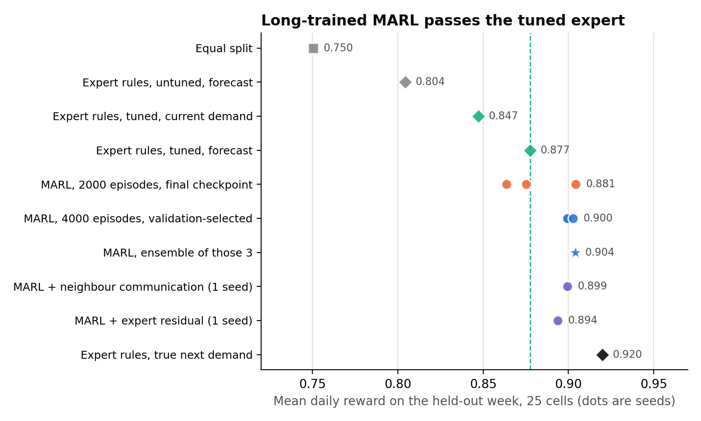
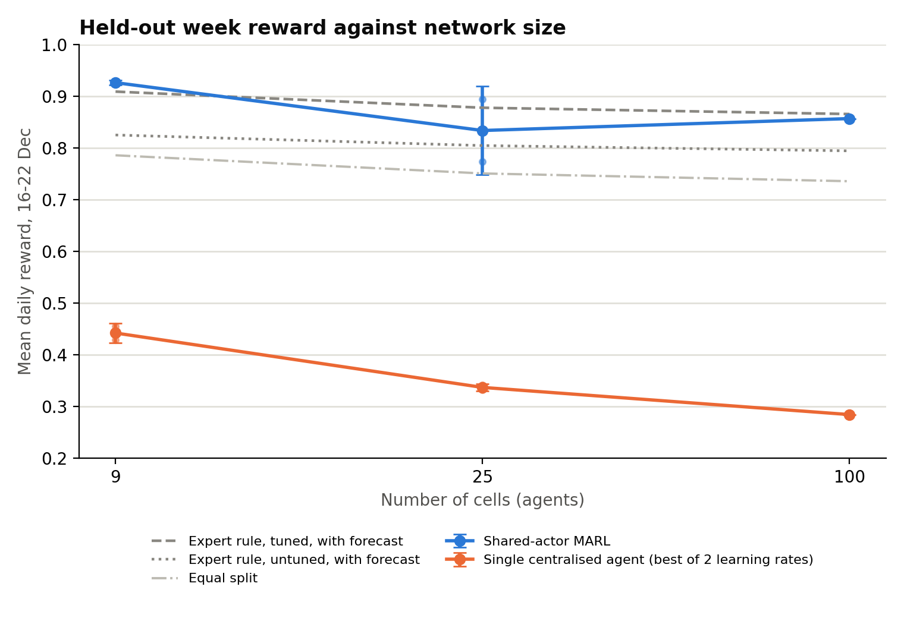
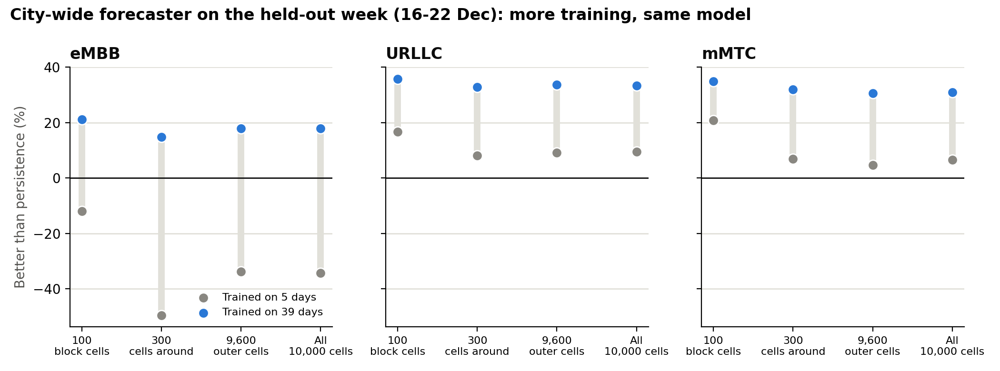
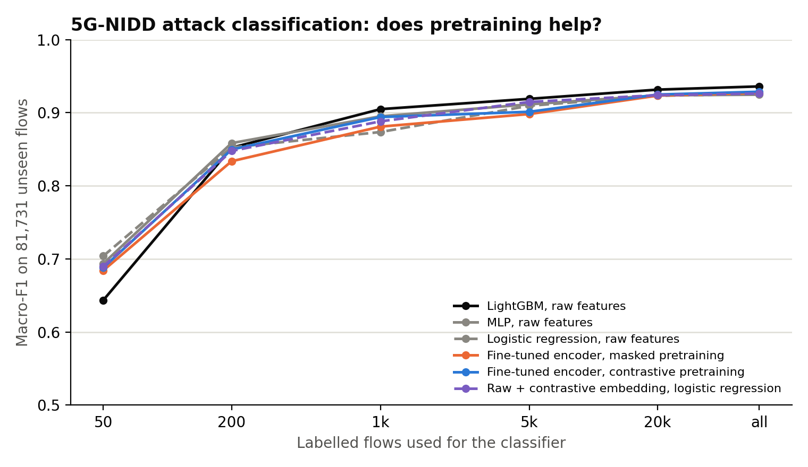

# Unified data, synthetic dataset, and why MARL

Response to the supervisor's review comments (12 Oct 2026):

1. Look for unified data that connects everything.
2. Why MARL, why not a single agent? (section 2)
3. If unified data is not available, create it synthetically.
4. Which datasets do the papers use?

Numbers in this document come from `reports/unified/` and can be regenerated with
the commands at the end.

## 4. Which datasets do the papers use?

All 16 papers in `docs/Literature_Review_Notes.md`:

| # | Paper | Data used | Kind |
|---|---|---|---|
| 1 | Ali & Arslan (2025), AI-driven DTs for slicing with NTNs | Custom Python 5G simulator, 50 UEs, 20 MHz | Own simulator |
| 2 | Li et al. (2026), multi-agent learning for RAN slicing | NS-3 RAN slicing simulator | Own simulator |
| 3 | Chowdhury et al. (2025), semantic slicing framework | None (conceptual, Python/TensorFlow) | None |
| 4 | John (2026), GAN-enhanced DRL for semantic slicing | Custom 6G slicing simulator, GAN-generated traffic | Own simulator |
| 5 | MARL for vehicular slicing (2023) | Mininet emulator + Ryu SDN controller | Own emulator |
| 6 | Native network DT architecture for 6G (2025) | Operator-inspired signalling-storm scenario, no public data | Private |
| 7 | Attention to virtualization, slicing-aware DTs (2025) | Docker UPF measurements + extended OMNeT++ | Own testbed + simulator |
| 8 | GNN-based DT for slicing management (2022) | NSFNET (14 nodes), GEANT2 (24), synthetic 50-node topologies | Public topologies + synthetic |
| 9 | SSL for wireless networks, survey (2024) | None (survey) | None |
| 10 | Net2Net, SSL network representation (2025) | Cora, Citeseer, DBLP, PubMed, GitHub, Facebook, LastFM Asia, Twitch | Public graph benchmarks (not telecom) |
| 11 | Encrypted traffic classification with SSL (2022) | Self-generated SDN traffic (Mininet + D-ITG) | Own generated |
| 12 | Network slice mobility for 6G (2022) | Discrete-time simulation | Own simulator |
| 13 | Slicing for AI (2025) | Mobile-health dataset, 245,921 samples | Public, not telecom |
| 14 | Self-supervised spatiotemporal GNN for traffic (2023) | METR-LA, PEMS-BAY, PEMS03/04/07/08 | Public road traffic |
| 15 | DRL for end-to-end slicing (2023) | OpenAirInterface / FlexRAN testbed | Own testbed |
| 16 | Self-optimizing 6G via network DT intelligence (2026) | Telecom Italia Milan | Public cellular traffic |

Summary: 8 of 16 generate their data with their own simulator, emulator or
testbed, one more builds synthetic topologies, three use non-telecom benchmarks,
one uses private operator data, and two use none. Only one uses public cellular
traffic (Milan, which we also use). **No paper uses a public dataset that unifies
topology, per-slice traffic, QoS and allocation decisions**; generating the data
is the normal practice in this literature.

## 1. Is there unified data?

What "unified" needs, one record joining: network topology, per-cell traffic over
time, per-slice demand, QoS (latency, jitter, loss), SLA outcome, and the
allocation action with its reward.

| Dataset | Topology | Traffic over time | Slice types | QoS | Actions / reward |
|---|---|---|---|---|---|
| Telecom Italia Milan (we hold, 62 days) | Grid layout only | Yes, 10-min, 10,000 cells | Services (internet/call/SMS), not slices | No | No |
| NeversNet5G (we hold) | gNB/UE positions | Yes, per UE | No | SINR/CQI/throughput | No |
| B5G slicing, Farreras et al. 2024 (we hold) | Transport topologies | No (static samples) | eMBB/URLLC/mMTC | Recorded `delta` only; latency/jitter/loss null in 0 of 4,350 sampled slices | Admission scenarios, no action log |
| 5G-NIDD (we hold) | No | Flows | No | No | No |
| 6G RAN telemetry FL, Kaggle (we hold) | No | Yes, 200 clients x 150 windows | Slice mix proportions | PRB load, p50/p95 latency, SLA flag | Reward column, no actions |
| DeepSlice / Kaggle slicing sets (we hold) | No | Day/time fields | Slice label | Packet loss and delay budgets | No |
| Botez et al. 6G slicing (we hold) | No | No | 6G slice classes | Latency/jitter/loss budgets | No |
| O-RAN slicing traces (e.g. Colosseum/ORANSlice work) | Single-cell testbeds | Yes | eMBB/URLLC | PRB, throughput, latency | Release not confirmed |

Web search (Oct 2026) found nothing that combines all six. The closest public
sources are the Farreras B5G set, which is transport-only with no RL action
logs, and O-RAN slicing traces, which are single-cell with no confirmed data
release. So the answer to (1) is no, and we followed (3).

## 3. The synthetic unified dataset

We built one, grounded in real data wherever real data exists (`src/unified/`):

| Piece | Source |
|---|---|
| Traffic per cell, every 10 minutes | Real: Telecom Italia Milan |
| Topology | Real: the Milan grid's cell layout and geographic adjacency |
| Slice demand | Milan's three services mapped to slices: internet → eMBB, calls → URLLC, SMS → mMTC |
| Latency, jitter vs load | Calibrated: curves fitted to the public 6G RAN telemetry dataset (30,000 windows) |
| Loss, SLA | Rules from the same SLA targets as our B5G environment |
| Interference between cells | Modelled: capacity falls with neighbours' load |
| Actions, rewards | From an environment that can be run live or logged to disk |

Two products:

- **Short dataset for the experiments** (`src/unified/dataset.py`): 7 days x 100 cells,
  100,700 rows, with the TGNN forecast and a logged behaviour policy. Sample:
  `reports/unified/unified_dataset_sample.csv`.
- **Digital Twin dataset** (`src/unified/twin_dataset.py`), 393.6 million rows x 122 columns in two builds:
  - **Core year:** 364 days x 400 cells x 6 scenarios (baseline, events, 6G growth, energy saving, industrial URLLC, massive IoT).
  - **Full city:** all 10,000 Milan cells x 62 recorded days x 3 scenarios.

  It also carries injected events (flash crowds, outages, interference, URLLC bursts, mMTC storms,
  degradations), multi-horizon forecasting targets, 3GPP CQI/MCS, EARTH energy, and noisy
  telemetry with gaps. Datasheet: `docs/Unified_Twin_Dataset.md`.

**Is it realistic?** Two checks (`reports/unified/dataset_checks.json`):

- Traffic keeps Milan's real daily cycle (about 19 Mbps per cell at 5 am, about 51 Mbps
  in the afternoon), because it is Milan's traffic.
- eMBB SLA rate against load, compared with the reference dataset's own SLA label.
  With a deterministic latency model the match was poor (mean gap 0.086: SLA flipped
  from always met to never met at 68% load). Adding per-window latency variation
  (one parameter, σ = 0.21, fitted to that reference curve) brings the mean gap to
  **0.021** across 15 load bins, e.g. 0.934 vs 0.919 at 57% load and 0.231 vs 0.264 at
  77%. Because σ was fitted on this curve, this is a goodness-of-fit, not an independent
  test.

Limits: QoS is a calibrated model rather than a packet-level simulation; the
reference telemetry is itself simulated by its authors; the slice mapping and
interference coupling are assumptions, kept in one config (`ModelConfig`) so they
can be varied.

## 2. Why MARL and not a single agent?

Every number below is on a **held-out week** (16-22 Dec 2013, days 45-51), never used for training,
tuning or checkpoint choice; the unit is the mean reward of one day, 7 days per run. Controllers are trained
on days 1-40 and see the TGNN v2 forecast (section 5). Reward 1.0 means every SLA met and all demand served.
Code: `src/unified/marl_v2*.py`; results: `reports/unified/marl_v2_*.json`.

Two learners, the same reward and the same training budget:

- **Single agent:** one centralised actor sees every cell (state = N x 17) and outputs every cell's slice
  shares (N x 4). Run with two actor learning rates (1e-4 and 3e-4); the better is reported.
- **MARL:** one actor shared by all cells, each acting on its own 17 local features, with a critic that also
  sees the mean of its grid neighbours' observations and actions and a team reward mixing each cell's reward
  with its neighbours'.

And three non-learning references, because beating a badly tuned rule proves little:

- **Equal split.**
- **Expert rules:** URLLC and mMTC capacity sized to a target utilisation, the rest to eMBB. The *untuned* version
  uses hand-set targets (0.50 / 0.65). The *tuned* version has those two targets chosen by grid search on the training
  days (for 25 cells: 0.4 / 0.4), with the forecast or with current demand.
- **Expert rules on the true next demand** (an upper bound for this rule).

### 2.1 The single agent does not scale; MARL does

1,000 episodes for every learner, final checkpoint, 2 seeds (100 cells: 1 seed):

| Cells | MARL | Single agent (best of 2 rates) | Equal split | Expert, untuned + forecast | Expert, tuned + forecast | Actor parameters, MARL / single |
|---|---|---|---|---|---|---|
| 9 | **0.926** (0.929, 0.923) | 0.442 | 0.785 | 0.825 | 0.909 | 19,332 / 114,468 |
| 25 | **0.833** (0.894, 0.773) | 0.337 | 0.750 | 0.804 | 0.877 | 19,332 / 200,548 |
| 100 | **0.857** (0.857) | 0.284 | 0.735 | 0.794 | 0.865 | 19,332 / 604,048 |

- **The single agent is far worse at every size and gets worse as the network grows** (0.442 at 9 cells, 0.284 at 100),
  below even equal split. This is not a learning-rate effect: both rates give about the same result, and its training reward
  barely moves between episodes 500 and 1,000 at 25 and 100 cells (0.31 to 0.32; 0.28 to 0.28). Its input and output grow with the number of cells (400 outputs at 100 cells) and its actor with them.
- **MARL's actor stays at 19,332 parameters** at every size, because every cell's experience trains the same actor.
  It can be applied to a network of any size.
- **It matches how a RAN is run:** each cell decides from its own and its neighbours' measurements, with no central
  controller collecting the whole network's state every 10 minutes and no single point of failure.
- **With this short budget MARL is about level with the tuned expert rules** (better at 9 cells, worse at 25 and 100: 0.926 vs 0.909 at 9 cells, 0.833 vs 0.877 at 25,
  0.857 vs 0.865 at 100), and at 25 cells the two seeds disagree (0.894, 0.773). Section 2.2 shows what longer training does.

### 2.2 Trained long enough, MARL beats the tuned expert rules (25 cells)

The 1,000-episode runs were still improving. With **4,000 episodes and the checkpoint chosen on validation days 41-44**
(`marl_v2_best.py`), three seeds reach 0.899, 0.899, 0.903, and the average of the three actors is **0.904**.

| 25 cells, held-out week | Reward |
|---|---|
| Equal split | 0.750 |
| Expert rules, untuned, current demand | 0.775 |
| Expert rules, untuned, with forecast | 0.804 |
| Expert rules, tuned, current demand | 0.847 |
| Expert rules, tuned, with forecast | 0.877 |
| MARL, 2,000 episodes, final checkpoint, 3 seeds | 0.881 ± 0.021 |
| **MARL, 4,000 episodes, validation-selected, 3 seeds** | **0.900** (0.899, 0.899, 0.903) |
| **MARL, ensemble of those 3 actors** | **0.904** |
| Expert rules on the true next demand (upper bound for the rule) | 0.920 |

- **MARL beats the tuned expert with the forecast by +0.026 (95% CI +/-0.005) for the ensemble, positive on 7 of 7 days;**
  each seed alone gains +0.022, +0.022, +0.025, also on 7 of 7 days. Against the tuned expert on current demand it gains +0.057.
- **Where the gain comes from** (`marl_v2_diagnosis.json`): MARL reserves about twice the expert's capacity for URLLC and mMTC
  (23% / 9% of each cell against 11% / 4%),
  so those slices meet their SLA 99% / 100% of the time against 80% / 61%,
  and it gives up a little eMBB (68% against 72% SLA, 92.4% against 94.8% of demand served).
  That is the trade the reward asks for, found from data rather than set by hand. The grid-searched expert finds a similar
  trade with two numbers, which is why it is the right opponent.
- **Tricks that did not help.** Letting each actor see its neighbours' observations (0.899), starting from the tuned expert and learning a
  correction (0.894), or both (0.892), single seed each, add nothing measurable to plain MARL trained long (0.899-0.903).
  An expert-regularised actor loss (TD3+BC form) without the forecast reached 0.844 (3 seeds), no better than plain MARL.
- **Seed instability matters.** The final-checkpoint runs span 0.864-0.904; choosing the checkpoint on validation days removes most of that spread (0.899-0.903) and is what turns "ties the expert" into "beats it".




### 2.3 The forecast helps both controllers; a changed traffic mix does not favour MARL

- **Expert rules.** On the held-out week the TGNN forecast lifts the untuned expert by +0.029 reward (95% CI +/-0.006, positive on 7/7 days at 25 cells, similar at 9, 49 and 100),
  recovering about 20% of the gap to the true next demand; the tuned expert gains +0.030.
  "Same time yesterday" used as the forecast is *worse* than current demand (0.758 vs 0.775).
  The first study, on 2 test days, had shown +0.04 to +0.05.
- **MARL.** With the forecast MARL scores 0.881 ± 0.021 and without it 0.851 ± 0.077 (3 seeds each, 2,000 episodes, final checkpoint): a gain of
  +0.030, but the seeds overlap, so it is not established. The earlier "forecast does not help MARL" result (0.765 vs 0.778) came from a 300-episode run on 5 days and is superseded.
- **A changed traffic mix.** Trained and tuned on ordinary traffic and scored *without retraining* on a 6G-growth mix (eMBB x1.3, URLLC x2, mMTC x3) and a massive-IoT mix (mMTC x10):

| Held-out week | Equal split | Tuned expert + forecast | MARL + forecast | MARL, no forecast |
|---|---|---|---|---|
| Recorded traffic | 0.750 | 0.877 | 0.881 ± 0.021 | 0.851 ± 0.077 |
| 6G-growth mix | 0.615 | 0.762 | 0.724 ± 0.028 | 0.692 ± 0.062 |
| Massive-IoT mix | 0.666 | 0.725 | 0.672 ± 0.024 | 0.685 ± 0.015 |

  The trained controllers lose to the hand-tuned rule once the mix changes. So the case for MARL here is *finding the policy from data without hand
  tuning and scaling to any number of cells*, not robustness to shifts it was not trained on.

### 2.4 What this does and does not show

1. Against a single centralised agent, shared-parameter MARL is much better and scales; this is the answer to "why not a single agent".
2. Against a well-tuned rule, MARL is better by about 0.03 reward at 25 cells when trained long with checkpoint selection, and only equal to it with a short budget.
3. The result at 25 cells has not been repeated at 9 and 100 cells with the long protocol (4,000 episodes would take hours at 100 cells), 100 cells has one seed in the scaling table, and every number is one
   region, one week and a calibrated surrogate environment, not a packet-level simulator.
4. The expert baseline has two tuned numbers; a richer tuned baseline (per-hour targets, per-cell targets) might close part of the gap.
5. Decision time is not a differentiator at this size: both take about 0.1-0.2 ms per decision on a CPU.

The first study (`reports/unified/results.json`: 5 training days, 300 episodes, 2 test days) is **superseded** by everything above.
It under-trained both learners and is kept only for the record.

## 5. The forecaster (TGNN v2) and self-supervised learning

**Forecaster** (`src/unified/forecast_city_v2.py`; `reports/unified/forecast_city_v2.json`). The GraphSAGE + GRU model, trained on 39 real days (days 5 and 6 held out entirely),
random 32 x 32 patches of the grid, per-cell scaling, "same time yesterday" and time of day as inputs, a residual head with no ceiling, validation on days 41-44.
Test: the held-out week, every one of the 10,000 cells. Improvement in mean squared error over repeating the last value:

| Cells | Trained on 5 days (earlier) | Trained on 39 days (v2) |
|---|---|---|
| 100 block cells | -12% / +17% / +21% | **+21% / +36% / +35%** |
| 300 cells around | -49% / +8% / +7% | **+15% / +33% / +32%** |
| 9,600 outer cells | -34% / +9% / +5% | **+18% / +34% / +31%** |
| All 10,000 cells | -34% / +9% / +7% | **+18% / +33% / +31%** |

(eMBB / URLLC / mMTC.) Training length was the problem: the 5-day version of the same model is worse than persistence on eMBB in this week.
A first forecaster trained only on the 100 central cells over-predicted the quiet outer cells and was 10.8 times worse than persistence there, which is why the
city version uses per-cell scaling and patch training. Seasonal baselines are much worse than persistence at a 10-minute horizon
("same time yesterday": 7 to 8 times its eMBB error; 4.7 times in an independent check on raw data), so persistence is the baseline to beat.


**Self-supervised learning** (`src/unified/ssl_nidd.py`; `ssl_nidd.json`, `ssl_nidd_scarf.json`). The first 5G-NIDD evaluation was flawed:
807,235 of 1,215,890 flows (66%) are exact duplicates, so identical flows sat in both train and test, and row-index columns leaked identity.
After de-duplication (408,655 flows), dropping identifier columns, a stratified split, and nine attack classes, we tested masked-feature and contrastive (SCARF) pretraining with 50 to all labelled flows:

| Labelled flows | Raw features, LightGBM | Raw features, MLP | SSL embedding (masked), logistic regression | Fine-tuned encoder (contrastive) | Raw + contrastive embedding |
|---|---|---|---|---|---|
| 50 | 0.643 | 0.694 | 0.627 | 0.688 | 0.690 |
| 200 | 0.852 | 0.858 | 0.763 | 0.850 | 0.848 |
| 1,000 | 0.905 | 0.895 | 0.859 | 0.894 | 0.888 |
| 5,000 | 0.919 | 0.911 | 0.901 | 0.901 | 0.915 |
| 20,000 | 0.932 | 0.924 | 0.913 | 0.925 | 0.924 |
| all | 0.936 | 0.925 | 0.912 | 0.929 | 0.926 |

Macro-F1 on 81,731 unseen flows (5 label draws up to 5,000 labels, 2 above). Raw features reach 0.926 to 0.936, against the old 0.708, so most of the earlier gap was the leakage.
**Pretraining never gives a reliable advantage over raw features at any label budget**: it is no better than the best raw-feature model at any budget (at 50 labels LightGBM itself is the weakest, but a raw-feature MLP or logistic regression, 0.694 and 0.704, beats the fine-tuned encoder, 0.688), it ties with all labels, and it adds at most +0.014 to a linear model at 1,000 to 5,000 labels.
This is a negative result and is reported as one.


## Regenerate

```bash
python src/unified/forecast_city_v2.py          # city forecaster v2 (about 45 min on CPU)
python src/unified/forecast_value_v2.py         # value of the forecast to the expert rules, held-out week
python src/unified/marl_v2.py refs              # reference policies; ddpg_fc / bc_fc / bc_nofc for the variants
python src/unified/marl_v2_tuned_expert.py      # expert rules tuned on the training days
python src/unified/marl_v2_scaling.py 3         # also 5 and 10; then marl_v2_scaling_refs.py
python src/unified/marl_v2_best.py train 0      # also 1 and 2; then: marl_v2_best.py report
python src/unified/marl_v2_plus.py comm 0       # also res, comm_res; then: marl_v2_plus.py report
python src/unified/marl_v2_shift.py ddpg_fc     # also ddpg_nofc, experts
python src/unified/marl_v2_diagnose.py
python src/unified/ssl_nidd.py ; python src/unified/ssl_nidd.py scarf
python src/unified/figures.py
```
